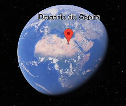
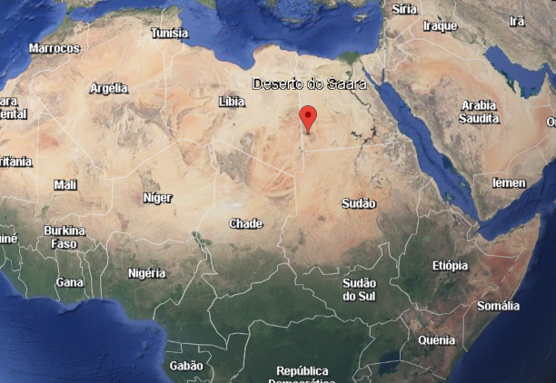

# Projeto: Visualização de Zonas Desérticas e Camadas de Areia (Uniformes e Dunas)

**Aluna:** Evelyn Kauany Lemes da Silva
**Disciplina:** Ciência de Dados, Computação Gráfica e UX/UI
**Tema Designado:** Zonas Desérticas e Camadas de Areia (Uniformes e Dunas)

## 🚀 ETAPA 1: Ciência de Dados & Lógica

O arquivo `script.py` contém a função `carregar_camada_satelite(lista_altitudes)`. O algoritmo simula o sistema de *Level of Detail* (LoD) do Google Earth/TerraVision. Ele recebe uma lista de altitudes e, utilizando estruturas condicionais (`if`, `elif`, `else`), define o nível de renderização:

*   **Altitude > 10.000m:** Baixa Resolução (Mosaico geral das zonas áridas do planeta).
*   **Altitude entre 1.000m e 10.000m:** Média Resolução (Mapeamento regional de campos de dunas e ventos).
*   **Altitude < 1.000m:** Alta Resolução (Detalhes finos da textura da areia, cristas e sombras das dunas).

## 🎨 ETAPA 2: Computação Gráfica & UX/UI

### 1. Processamento e Tratamento de Imagem (Desafios do Tema)
Renderizar desertos e dunas em um sistema como o Google Earth apresenta desafios únicos de processamento de imagem:
*   **Falta de Contraste e Monocromia:** Desertos são grandes extensões de uma única cor (tons de bege/areia). O algoritmo de "stitching" (costura de imagens de satélite) enfrenta dificuldade em encontrar pontos de referência (features) para alinhar perfeitamente as bordas das imagens, podendo gerar emendas visíveis ou repetições de padrão (tiling).
*   **Sombras Dinâmicas e Relevo:** As dunas mudam de forma e posição com o vento. O sistema precisa processar mapas de normais (Normal Maps) para simular a iluminação correta do sol sobre as cristas das dunas, criando sombras realistas que dão a sensação de profundidade em um terreno que, visto de cima, pode parecer "plano".
*   **Reflexo e Albedo:** A areia tem alta refletividade. É preciso ajustar a uniformização de cor para evitar que áreas com sol a pino fiquem "estouradas" (superexpostas) e percam a textura.

### 2. Design de Interface e Leis da Gestalt
Na interface do Google Earth, ao buscar por desertos como o Saara ou o Deserto do Atacama, podemos observar:
*   **Lei da Proximidade:** Na barra lateral de pesquisa, os resultados (ex: "Deserto do Saara", "Dunas de Merzouga") agrupam-se por proximidade geográfica. Isso ajuda o usuário a navegar rapidamente entre pontos de interesse no mesmo bioma.
*   **Lei da Continuidade:** As linhas de grade (grid) e os contornos de relevo (quando ativados) ajudam o olho a seguir a direção das cristas das dunas. O design gráfico orienta o zoom de forma intuitiva, mantendo a suavidade da transição (interpolação) à medida que a câmera desce. Se você der zoom em uma duna, o sistema utiliza a "continuidade" para não quebrar a percepção de escala, carregando as texturas de alta resolução sem saltos bruscos.

### 3. Imagens/Evidências
*(Insira aqui no seu repositório a captura de tela do Google Earth mostrando um deserto ou campo de dunas, como o Deserto do Saara, Atacama ou Lençóis Maranhenses. Salve a imagem na pasta do projeto e referencie abaixo)*

---

## 🎤 ETAPA 3: Roteiro do Pitch Oral (2 a 3 minutos)

> *"Olá, professora e colegas. Meu nome é Evelyn Kauany e meu tema designado foi **Zonas Desérticas e Camadas de Areia (Uniformes e Dunas)**.*
> 
> *Na **Etapa 1**, desenvolvi um código em Python que simula o sistema de LoD (Level of Detail) do Google Earth. O grande desafio de sistemas como o TerraVision é não sobrecarregar a memória. No meu código, usei `if/elif/else` para ler as altitudes. Quando a câmera está a mais de 10 mil metros, o sistema carrega apenas um mosaico geral de baixa resolução. Quando desce para entre 1.000 e 10.000 metros, ele carrega o mosaico regional, onde já conseguimos ver os campos de dunas. E, abaixo de 1.000 metros, o código ativa a alta resolução, renderizando detalhes finos como a textura da areia e as sombras das cristas das dunas.*
> 
> *Na **Etapa 2**, analisei a Computação Gráfica do meu tema. O maior desafio gráfico em desertos é a falta de contraste. Como a areia é muito uniforme, o algoritmo de 'stitching' (costura de imagens) sofre para alinhar as fotos de satélite sem deixar emendas visíveis. Além disso, precisei entender como as sombras são processadas para dar volume às dunas.*
> 
> *Por fim, usei as **Leis da Gestalt** na interface. A **Lei da Proximidade** aparece na organização dos resultados de busca, agrupando pontos turísticos no mesmo deserto. E a **Lei da Continuidade** guia o olhar do usuário: quando damos zoom em uma duna, o sistema faz a transição suave das texturas, mantendo a percepção de escala e orientando nossa navegação de forma intuitiva. Obrigada!"*

---

### Checklist para você (Evelyn):

1.  [ ] **Criar repositório público** no GitHub.
2.  [ ] **Colar o código** da Etapa 1 no arquivo `script.py`.
3.  [ ] **Rodar o código** no seu computador (ou no Google Colab) para garantir que ele está funcionando e tirar um print do terminal (opcional, mas bom para o portfólio).
4.  [ ] **Abrir o Google Earth**, buscar um deserto (ex: Saara ou Lençóis Maranhenses) e **tirar um print**.
5.  [ ] **Salvar a imagem** no seu repositório (ex: na pasta `images/`) e ajustar o caminho no `README.md`.
6.  [ ] **Colar o texto da Etapa 2** no `README.md`.
7.  [ ] **Treinar o pitch** (Etapa 3) com base no roteiro que escrevi.
8.  [ ] **Enviar o link do repositório** no Google Classroom antes do prazo.

Boa sorte! O trabalho está bem estruturado e alinhado com o seu tema. Se precisar de mais alguma coisa, é só chamar.
